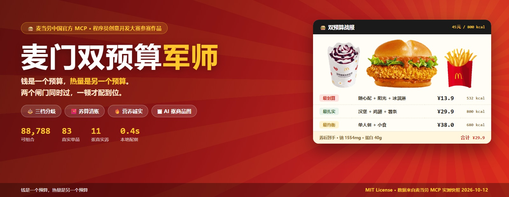
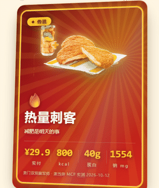
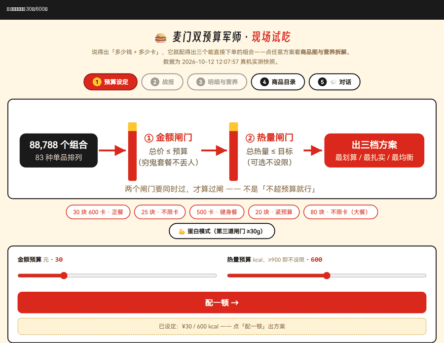
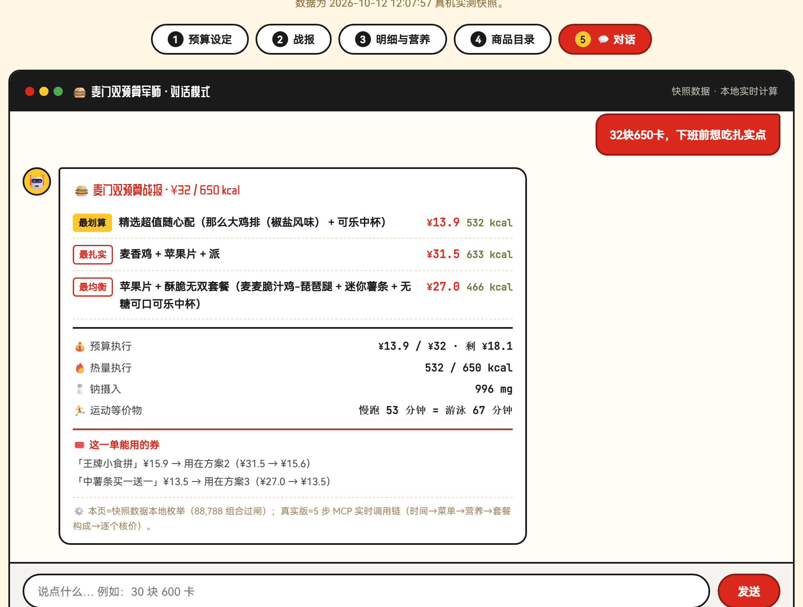
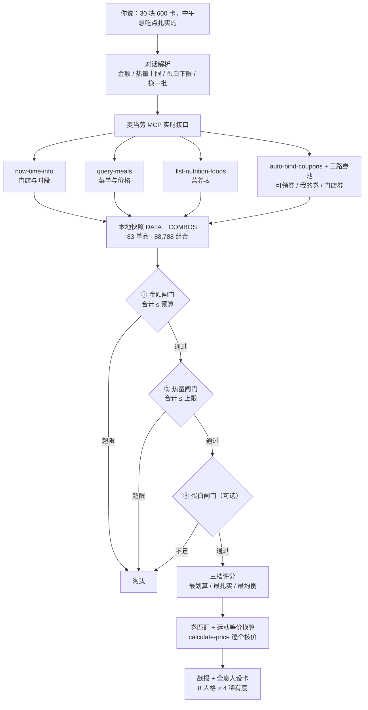
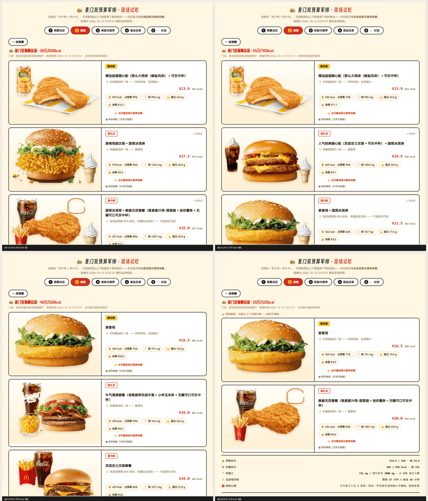

# 🍔 麦当劳预算及热量测算专家

> 英文名 McDualBudget Coach · 站内搜索词「麦门」「双预算」也在下方关键词段里

> ### 减脂期还想吃麦当劳？
> **说个预算和卡数，三档能直接下单的组合。**
>
> 例：「30 块、600 卡，中午想吃点扎实的」→ 三档方案 + 券后到手价 + 一张会闪的人设卡。

⭐ **本仓库参加麦当劳开发者大赛，名次只看 Star 数。** 觉得这套思路有用，就点一下右上角那个 **Star** —— 这一票直接决定排名。

## ▶ 在线试玩（点这里就能用，不用下载、不用装）

### 👉 [⚡ 点我进轻量版（965KB，秒开）](https://erikzeng2008-del.github.io/mcd-dual-budget-coach/lite.html) →

`https://erikzeng2008-del.github.io/mcd-dual-budget-coach/lite.html`

**功能与完整版一致，体积只有 1/12**——商品图是缩略图，手机流量也扛得住。三个入口按需选：

| 入口 | 体积 | 适合谁 |
|---|---|---|
| **[lite.html](https://erikzeng2008-del.github.io/mcd-dual-budget-coach/lite.html)** | **965KB** | **默认选它**。秒开，五屏功能齐全（预算→战报→明细→目录→对话）+ 人设卡 |
| [demo.html](https://erikzeng2008-del.github.io/mcd-dual-budget-coach/demo.html) | 11MB | 想看高清商品大图与套餐拼图，用电脑打开 |
| [card.html](https://erikzeng2008-del.github.io/mcd-dual-budget-coach/card.html) | 317KB | 只想看一眼会闪的全息人设卡 |

手机浏览器直接打开也行。不想用 Demo？先看[落地页](https://erikzeng2008-del.github.io/mcd-dual-budget-coach/)。

## 🃏 核心玩法：麦门全息人设卡（会闪、能存、能晒）

配完一顿，它不只告诉你「买什么」——还按这一顿的**真实数据**给你发一张会随视角流光溢彩的 3D 全息卡，鉴定你是哪种麦门人格、什么稀有度。

> ### 👉 [**点开直接看一张卡（317 KB，秒开，不用装不用配）**](https://erikzeng2008-del.github.io/mcd-dual-budget-coach/card.html)
> 打开就是一张会闪的「传说 · 热量刺客」**——而且它是真的在动**：不碰也会自己轻转、镭射自己扫，鼠标划过或手指拖动时切成跟手模式，四层视差跟着走。
> 在完整 Demo 里配完餐，还能**生成你这张卡的专属链接**——发给谁，谁点开看到的就是你的结果。



- **四层视差**：背景 / AI 抠图商品主体 / 金色线稿 / 文字，鼠标或手指拖动时分层错动
- **镭射彩虹**：光泽相位跟着视角走，转到哪闪到哪
- **8 种人格 + 4 档稀有度**：全部由预算使用率、热量达成率、蛋白、钠、品类数推导，**判定规则写在源码里，可以自己复算**
- **一键保存 / 复制链接 / 复制文案**：存图发朋友圈，或甩一条链接给别人——卡片自带项目地址

> 同一顿饭，预算 ¥45 时你是「自律型选手」，预算 ¥25 时变成「精准打击手」——数字变了，卡也变。

---

## 🎬 先看一眼（四步跑通：设定 → 三档 → 明细 → 对话）



> 说「多少钱 + 多少卡」，它给你三个能直接下单的组合——商品图全是 AI 抠图的真实照片，套餐按「主角优先」重新拼好，券会算清用完到手价。

## 🖼 素材档案（88 张商品图，AI 抠图、逐张审过）

商品图不是从网上随便找的——全部来自麦当劳官方商品图，经 **RMBG-2.0 神经网络抠图 + 暗色残留清理** 去底，四模型横评选型（u2net / RMBG-1.4 / BiRefNet / RMBG-2.0，实测 BiRefNet 反而最差）。

**👉 [素材档案审阅台](https://erikzeng2008-del.github.io/mcd-dual-budget-coach/matting-review.html)** —— 每张商品「原图 vs 抠图」左右对照，可逐张查边缘干不干净。抠图脚本 `ai_cutout.py` 已开源在本仓库，换模型只改一行路径。

<details>
<summary><b>⚠️ 在 GitHub 仓库文件列表里，别点这个（会报错）</b></summary>

- ❌ **仓库文件列表里的 `demo.html`** —— 它有 11 MB（真实商品图全部内嵌在单文件里），GitHub 的网页预览扛不住，会提示文件过大。
- ✅ 想本地跑：先把 `demo.html` **下载**下来，再双击用浏览器打开——本地打开完全没问题。
- ✅ **手机上想快点**：直接用上面的 `lite.html`（965KB），在线秒开，不用下载。

</details>

---

> **钱是一个预算，热量是另一个预算。两个都不超，一顿配到位。**

告诉它「30 块 600 卡，中午想吃点扎实的」，它基于麦当劳官方 MCP 实时菜单、营养数据和你的优惠券，配出三个能直接下单的组合——并诚实地告诉你：这顿等于慢跑 50 分钟。

> ⭐ **本仓库正在参加 [2026 麦当劳程序员创意开发大赛](https://github.com/M-China/mcd-developer-innovation-challenge)，排名唯一依据就是 GitHub Star 数。** 如果这个「预算和热量一起算」的思路对你有用，麻烦点一下页面右上角的 **Star**——这是支持它的唯一方式，也是决定它排名的那一票。

## 🎮 五屏都能玩（在线版）

数据是 2026-10-12 的实测快照（83 个可配单品、11 张真实优惠券、88,788 个可组合），**五屏随便玩**：

| 屏 | 玩什么 |
|---|---|
| 1 预算设定 | 拖滑块或点预设场景（含「蛋白模式」第三道闸门） |
| 2 战报 | 三个过闸方案（真实商品图）+ 预算/热量/钠执行 + 这一单能用的券 |
| 3 明细与营养 | 点开任一方案看六项营养拆解 |
| 4 商品目录 | 83 个单品全览，点进看单品营养 |
| 5 💬 对话 | **像真的一样打字**——「30 块 600 卡」回车，当场配给你 |

手机也能开。

     

## 它长什么样



> 这就是它的全部「界面」——**一段对话**。你说「多少钱 + 多少卡 + 想吃啥」，它回你三个能直接下单的组合。
> **在线 demo 的第 5 屏就是这个对话界面，可以亲手打字体验。**
> 图中顶部那排工具调用链是真实调用麦当劳 MCP 的 5 步（时间→菜单→营养→套餐默认档→逐个核价），价格由 `calculate-price` 实付核验——不是模型编的。这是本项目与「菜单静态表 + 拍脑袋推荐」类工具的根本区别。

## ⚙️ 数据流：从一句话到三档方案



**关键设计**：取数交给 MCP，**算术交给代码**，表达交给 Agent。菜单、营养、券都是 MCP 实时返回；组合枚举、双闸门过滤、三档评分全在本地算——不让大模型口算价格（点餐场景价格错一位就是事故）。

## 为什么做这个

想吃麦当劳的人心里都有两杆秤：

- 💸 **钱包秤**：「这个月得省着点」
- 🔥 **热量秤**：「今天热量余额只够 600 卡了」

市面上的点餐工具只管「点得快」，没人管「配得对」。本 Skill 把两杆秤做成**双闸门**：金额与热量任何一个超限的组合直接淘汰，剩下的按「最划算 / 最扎实 / 最均衡」给你三个答案，选哪个都不用做数学题。

## 快速开始

### 1. 获取麦当劳 MCP Token

访问 [麦当劳 MCP 开放平台](https://open.mcd.cn/mcp) → 手机号登录 → 右上角「控制台」→「激活」→ 复制 Token。

### 2. 在 WorkBuddy 中配置 MCP 连接器

左侧边栏【专家·技能·连接器】→【连接器】→ 右上角【自定义连接器】→【配置 MCP】→ 粘贴 [mcp-config.example.json](mcp-config.example.json) 的内容并将 `${MCD_MCP_TOKEN}` 替换为你的实际 Token → 保存并**启用** `mcd-mcp`。

### 3. 装载本 Skill

将本仓库的 `SKILL.md` 放入 WorkBuddy 技能目录（或在对话中直接粘贴给 AI 加载）。详细步骤参考 [WorkBuddy 官方文档](https://www.workbuddy.cn/docs/workbuddy/From-Beginner-to-Expert-Guide/Function-Description/Connector)。

### 不想装？先玩一下

直接用浏览器打开仓库里的 **[demo.html](demo.html)**（零外链、不含任何凭证），三屏玩转：

1. **拖滑块或点预设场景**（如「30 块 600 卡 · 正餐」）→「配一顿」
2. **战报屏**：三个过双闸门的组合（最划算 / 最扎实 / 最均衡），附预算执行、运动等价物、省钱心情，底部有「🔄 换一批」——同一预算再给你三个完全不同的组合（实测 30 元/600 卡有 40 个过闸组合，50 元不限卡 1280 个，三档只是入口不是上限）
3. **点任意方案 → 明细屏**：每个餐品的**真实商品图**（麦当劳接口返回）、单价、热量、单项营养素；套餐还展开默认构成（哪几件、各多少卡）；底部是这一单的**营养拆解**——能量、蛋白质、脂肪、碳水化合物、钠、钙六项合计及占参考值百分比

数据为 2026-10-12 的实测快照（83 个可配单品、88,788 个可组合），商品图与营养素均来自麦当劳 MCP 接口；真实版走实时接口，菜单随时段/门店变化。热量数据缺失的当季新品（约 35 个）会在「不设卡」场景参选并明确标注「未知」，不拿未知数字凑闸门。

## 使用示例

> 以下战报为 2026-10-09 在「麦当劳福州金洲南路餐厅」的**真实 MCP 实测输出**（非演示数据）：

```
你：30 块 600 卡，中午想吃点扎实的

🍔 麦门双预算战报
─────────────────────
方案一 · 最划算
  精选超值随心配 1+1（麦香鸡 + 小玉米杯）
  实付 ¥14.9｜总热量 422 kcal
方案二 · 最扎实
  「堡」你欢乐套餐（官方 500 大卡档）
  实付 ¥28.0｜总热量 500 kcal 档
方案三 · 最均衡
  麦辣鸡腿堡单点
  实付 ¥22.5｜总热量 485 kcal
─────────────────────
💰 预算执行：¥14.9 / ¥30，剩余 ¥15.1
🔥 热量执行：422 / 600 kcal，剩余 178 kcal
🏃 运动等价物：这顿 = 慢跑 42 分钟 = 游泳 53 分钟
🧧 省钱心情：你有张 ¥9.9 薯薯券今天到期，用上等于白赚一顿小食
```

其他玩法：

```
你：健身完只敢吃 500 卡，麦门还有救吗
你：25 块，早餐，要喝咖啡
你：帮我领下今天的券再配一顿 35 块的
```

> ⚠️ 菜单随时段/门店变化，每次输出都基于麦当劳 MCP 实时返回（`query-meals` / `list-nutrition-foods` / `calculate-price`），早餐和正餐配出来的组合不一样。

## 实测案例



全部案例来自真机实测（2026-10-10，麦当劳福州金洲南路餐厅），每个案例包含**完整调用链、每个数字的来源、复现说明**：

| 案例 | 场景 | 看点 |
|---|---|---|
| [案例 1 · 30元600卡](examples/case-1-30元600卡.md) | 金额+热量双闸门 | ¥13.9 随心配 1+1 = 532 kcal，预算剩一半 |
| [案例 2 · 25元性价比](examples/case-2-25元性价比.md) | 只限金额 | ¥22.9 干到 808 kcal 的满足感方案 |
| [案例 3 · 500卡健身餐](examples/case-3-500卡健身餐.md) | 只限热量 | 三方案 434~495 kcal 全过闸，官方大卡档对齐 |
| [案例 4 · 20元紧预算](examples/case-4-20元紧预算与券日历.md) | 紧预算+券 | 13 张券 0 张今日可用时的诚实处理 + 券日历 |

## 目标用户

| 人群 | 场景 |
|---|---|
| 🏃 健身/控糖人群 | 热量预算内吃麦当劳不破防 |
| 💰 学生党/省钱党 | 券+预算双卡，顿顿不超支 |
| 👨‍👩‍👧 宝妈/家庭用户 | 给孩子配一顿热量可控的开心乐园餐 |
| 🍔 麦门信徒 | 把「随便吃吃」升级成「精确吃吃」 |

## 两个只有真数据才能得出的结论

这两条不是设计出来的，是跑完 88,788 个组合后才发现的——**也是「静态菜单表 + 拍脑袋推荐」永远给不出的答案**：

**① 「随心配 1+1」是麦当劳藏得最深的省钱漏洞。**
同样吃「堡 + 可乐」，单买 ¥23.0 + ¥10.0 = ¥33.0，走随心配 1+1 只要 **¥13.9**——省 ¥19.1，够再买一个圆筒还剩。但菜单里它藏在「随心配」分类下，不枚举根本发现不了这个价差。

**② 「500 大卡套餐」比你自己拼更便宜、还更饱。**
官方 500 卡档套餐（如「酥脆无双套餐」¥20，434 kcal）vs 自拼「麦麦脆汁鸡 + 迷你薯条 + 无糖可乐」——同构成下套餐便宜 ¥2.5 且不用自己做算术。**控卡的人最该买的恰恰是官方热量档**，这与「套餐=不健康」的直觉相反。

## 已知限制（如实说明）

不藏短板，以下都是当前版本的真实边界：

1. **优惠券匹配是关键词规则，不是官方适用规则。** 券名含「薯条」→ 找含薯条的组合；官方接口不返回券的完整适用范围，因此可能存在误判。demo 中的券为 2026-10-12 快照。
2. **营养表与门店菜单是两套数据源。** 营养表约 160 条常见品，门店菜单前列是当季新品，实测零同名命中——需归一化对齐，已对齐 83 条，仍有约 35 个当季新品查不到热量，这些品在「设了热量预算」时不参选。
3. **套餐热量按官方默认档构成求和**，不模拟用户自选替换项后的热量变化。
4. **门店固定为实测门店**（福州金洲南路店），demo 不支持切店；真实版每次按地址重新定位。
5. **运动等价物按 70kg 成人估算**（慢跑 ≈10 kcal/分钟），非精确值。
6. **本 Skill 只报价不下单**——这是设计取舍不是缺陷，杜绝误支付。

## ✅ 自测与验证记录（43 项断言，2026-10-20 实跑）

逻辑不是「看起来对」，是「跑起来对」——自测直接跑在**发货的页面文件上**（不是另写一套镜像实现），覆盖数据完整性、双闸门、券匹配、边界诚实性、单文件自包含：

| 验证对象 | 命令 | 实测结果 |
|---|---|---|
| 完整版 `demo.html` | `python scripts/run_selftest.py` | **共 43 项 · 通过 43 · 失败 0** |
| 轻量版 `lite.html` | `python scripts/run_selftest.py lite.html` | **共 43 项 · 通过 43 · 失败 0**（证明压到 965KB 后功能无损） |
| 页面渲染 | headless Chrome 截图 | 首页 + 战报屏渲染正常（2026-10-20 实拍） |
| 单文件自包含 | 断言「整页零外部图片引用」 | 零外部依赖，通过 |

```bash
python scripts/run_selftest.py             # 完整版 demo.html
python scripts/run_selftest.py lite.html   # 轻量版 lite.html
# 共 43 项 | 通过 43 | 失败 0
```

实测抓过的真问题：**「麦乐鸡」没被识别为小食**，导致「王牌小食拼」券匹配不到——关键词表补上后修复。这类漏洞肉眼看不见，只有断言能逮住。

## 安全设计

- **只配餐不下单**：默认不调用 `create-order`，杜绝误支付（用户两次明确确认后才放行）
- **不默认领券**：`auto-bind-coupons` 仅在用户明确要求时执行
- **零硬编码数据**：价格/热量全部来自 MCP 实时返回，Skill 本体不保存任何餐品数据
- 详见 [CONTEST_DECLARATION.md](CONTEST_DECLARATION.md) 与 [MCP_INTEGRATION.md](MCP_INTEGRATION.md)

## 文件结构

```
mcd-dual-budget-coach/
├── SKILL.md                  # Skill 本体（触发判定/调用链/组合算法/输出格式）
├── README.md                 # 本文件
├── MCP_INTEGRATION.md        # 麦当劳 MCP 集成说明（Server/Tool/流程/价值）
├── mcp-config.example.json   # 脱敏 MCP 配置示例（环境变量占位符）
├── CONTEST_DECLARATION.md    # 参赛声明（官方原文）
├── workbuddy.md              # WorkBuddy 开发过程记录（专项奖励）
├── index.html                 # 落地页（三个入口分流：lite / demo / card）
├── lite.html                  # 轻量版演示页（965KB 秒开，五屏功能与完整版一致，零外链无凭证）
├── demo.html                  # 完整版演示页（11MB 高清商品图，五屏：预算→战报→明细→目录→💬对话）
├── demo-assets/               # 演示页用的商品图（86 张，来自麦当劳接口）
├── scripts/
│   ├── run_selftest.py        # 自测运行器（注入页面上下文 + 无头 Chrome 实跑）
│   ├── selftest.js            # 43 项断言集（跑在发货页面里，不是镜像实现）
│   └── make_lite.py           # lite.html 生成脚本（把 demo 压到 965KB，可重跑）
├── examples/
│   ├── demo-chat.png         # 产品界面：一次真实对话（首图）
│   ├── battle_reports.png    # 4 场景真机实测战报图
│   ├── case-1-30元600卡.md    # 双闸门实测：数字级溯源
│   ├── case-2-25元性价比.md   # 只限金额实测
│   ├── case-3-500卡健身餐.md  # 只限热量实测
│   └── case-4-20元紧预算与券日历.md # 紧预算 + 券日历诚实版
└── references/
    └── tools.md              # 本 Skill 使用的 MCP 工具速查
```

## 参赛信息

本项目参加 [麦当劳程序员创意开发大赛](https://github.com/M-China/mcd-developer-innovation-challenge)（2026.10.9 - 10.25），使用 [WorkBuddy](https://www.workbuddy.cn) 开发，参与 WorkBuddy 专项奖励。

---

## 关键词

> 方便搜索到这里。若你也在做麦当劳 MCP 相关的东西，欢迎在 Issues 交流。

**中文**：麦当劳 · 麦当劳 MCP · 麦当劳中国 · 麦门 · 麦当劳预算及热量测算 · 麦门双预算军师 · 双预算 · 减脂期吃麦当劳 · 麦当劳点餐 · 预算配餐 · 预算点餐 · 热量控制 · 卡路里 · 减脂餐 · 增肌餐 · 蛋白质 · 钠含量 · 营养配餐 · 优惠券 · 券后价 · 组合优化 · 最划算 · 性价比 · 点餐助手 · 智能点餐 · 配餐算法 · 穷举组合 · 麦当劳菜单 · 随心配 · 巨无霸 · 麦乐送 · 外送 · 到店自取 · 麦当劳程序员创意开发大赛 · WorkBuddy · 技能 · 智能体 · 全息卡 · 人设卡 · 闪卡 · 轻量版 · lite · 秒开 · 单文件

**English**：McDonald's China · McDonald's MCP · mcd-mcp-server · MCP server · Model Context Protocol · agent skill · WorkBuddy skill · AI agent · meal planner · budget meal · calorie budget · calorie tracking · macro friendly · high protein · nutrition · sodium · coupon optimizer · deal finder · meal combination · optimization · food ordering assistant · Three.js · holographic card · persona card · trading card · lightweight · single file · fast load

---

*项目输出仅供参考，不构成医疗或营养建议。餐品信息、价格及供应状态以麦当劳官方渠道实时结果为准。*
